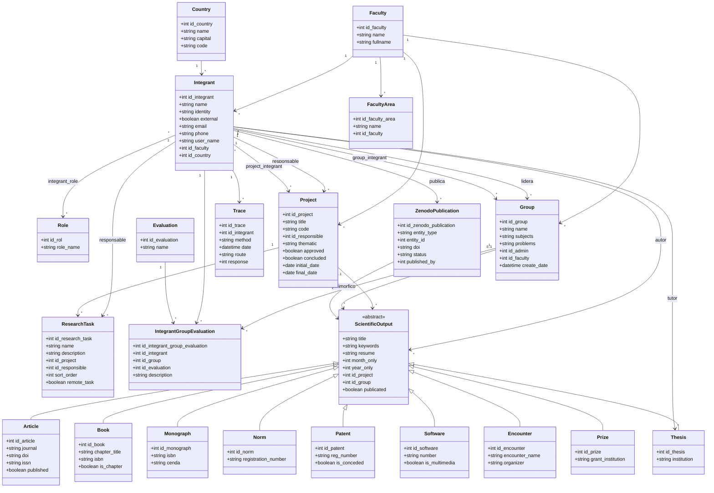

# Diagrama UML de Clases — SGI (Sistema de Gestión Integral de Investigación)

Documento completo para generar un diagrama UML del sistema. Incluye **base de datos PostgreSQL**, **backend FastAPI**, **frontend React** y **servicio de IA (modelo)**.

---

## 1. Descripción general del sistema

**SGI** es un sistema de gestión de investigación universitaria (CUJAE) que administra:

- **Personas** (integrantes/investigadores) con roles, grados académicos y afiliación organizacional.
- **Grupos de investigación** con miembros, evaluaciones y líderes.
- **Proyectos de investigación** con tareas, estados, clasificación y presupuesto.
- **Registros científicos** (9 tipos de producción: artículos, libros, monografías, normas, patentes, software, eventos, premios, tesis).
- **Auditoría** (trazas de peticiones HTTP).
- **Publicación en Zenodo** (repositorio externo).
- **Asistente IA** (consultas en lenguaje natural sobre la base de datos vía LM Studio).

### Arquitectura en capas

```
┌─────────────────────────────────────────────────────────────┐
│  FRONTEND (React + TypeScript + Vite)                       │
│  Páginas: Usuarios, Grupos, Proyectos, Registros, Stats... │
└──────────────────────────┬──────────────────────────────────┘
                           │ HTTP (REST)
┌──────────────────────────▼──────────────────────────────────┐
│  BACKEND SGI (FastAPI, puerto 8000)                         │
│  33 entidades SQLAlchemy + 13 tablas de asociación          │
└──────────────────────────┬──────────────────────────────────┘
                           │ SQL
┌──────────────────────────▼──────────────────────────────────┐
│  BASE DE DATOS PostgreSQL (50 tablas, schema public)        │
│  Dump: db/sgi_database.sql                                  │
└─────────────────────────────────────────────────────────────┘

┌─────────────────────────────────────────────────────────────┐
│  MODELO IA (FastAPI, puerto 8001) — servicio separado       │
│  Chat + Ask-Data (text-to-SQL) → LM Studio                  │
└─────────────────────────────────────────────────────────────┘
```

---

## 2. Paquetes UML propuestos

| Paquete UML | Contenido |
|-------------|-----------|
| `catalogos` | Países, facultades, grados, tipos, estados, evaluaciones |
| `personas` | Integrant, Role, IntegrantRole |
| `organizacion` | Faculty, FacultyArea, Group, GroupIntegrant |
| `proyectos` | Project, ProjectIntegrant, ResearchTask, SpecificObjective*, ExpectedResult* |
| `registros` | Article, Book, Monograph, Norm, Patent, Software, Encounter, Prize, Thesis |
| `registros.asociacion` | *_authors, theses_tutors |
| `auditoria` | Trace |
| `integraciones` | ZenodoPublication |
| `frontend.dto` | Tipos TypeScript (API payloads, RegistroBase, IUser) |
| `ia` | AskDataRequest, AskDataResponse (modelo) |

\* Tablas en BD sin modelo backend aún implementado.

---

## 3. Enumeraciones

### RecordType (frontend)
```
articulo | libro | monografia | norma | patente | software | evento | premio | tesis
```

### UserRole (frontend, roles de UI)
```
admin | integrant | consejo | responsable_proyecto | responsable_grupo |
integrante_proyecto | integrante_grupo | consejo_cientifico | autor_registro | publicador | usuario
```

### ZenodoEntityType
```
article | book | monograph | norm | patent | software | encounter | prize | thesis
```

### ZenodoPublicationStatus
```
draft | published | failed
```

---

## 4. Catálogos / Entidades de referencia

Todas son clases simples con `id_*` (PK) y `name` (String). No tienen relaciones salientes complejas salvo las indicadas.

### Country
- **Tabla:** `countries`
- **Atributos:** `id_country: int`, `name: string`, `capital: string`, `code: string`
- **Relaciones:** 1 → N con Integrant y todos los registros científicos

### Faculty
- **Tabla:** `faculty`
- **Atributos:** `id_faculty: int`, `name: string`, `fullname: string`
- **Relaciones:** 1 → N FacultyArea, Integrant, Group, Project

### FacultyArea
- **Tabla:** `faculties_areas`
- **Atributos:** `id_faculty_area: int`, `name: string`, `id_faculty: int` (FK)
- **Relaciones:** N → 1 Faculty; referenciada por Integrant y Group

### DocentDegree
- **Tabla:** `docent_degree` — `id_docent_degree`, `name`

### CientificDegree
- **Tabla:** `cientific_degree` — `id_cientific_degree`, `name`

### GeneralCategory
- **Tabla:** `general_category` — `id_general_category`, `name`

### Role
- **Tabla:** `roles`
- **Atributos:** `id_rol: int`, `role_name: string` (único)
- **Relaciones:** N ↔ M Integrant (vía IntegrantRole)

### ArticleType
- **Tabla:** `articles_types` — usado por Article

### EncounterType
- **Tabla:** `encounters_types` — usado por Encounter

### NormType
- **Tabla:** `norms_types` — usado por Norm

### PrizeType
- **Tabla:** `prizes_types` — usado por Prize

### ThesisType
- **Tabla:** `theses_types` — usado por Thesis

### ProjectType
- **Tabla:** `project_type` — usado por Project

### ProjectState
- **Tabla:** `project_state` — usado por Project

### ProjectClassification
- **Tabla:** `project_classification` — `id`, `name`, `code`

### ResearchTaskState
- **Tabla:** `research_task_state` — usado por ResearchTask

### Evaluation
- **Tabla:** `evaluation` — usado por IntegrantGroupEvaluation

### ExpectedResultState *(solo BD)*
- **Tabla:** `expected_result_state`

---

## 5. Entidad central: Integrant

**Clase:** `Integrant` — **Tabla:** `integrant`

Representa a un investigador, docente o usuario del sistema. Es el **hub central** del diagrama.

### Atributos
| Atributo | Tipo | Descripción |
|----------|------|-------------|
| id_integrant | int | PK |
| name | string | Nombre completo |
| identity | string | Carné de identidad |
| external | boolean | ¿Es externo a la institución? |
| email | string | |
| phone | string | |
| available_time | int | Fondo de tiempo |
| work_center | string | Centro de trabajo |
| curriculum | string | CV |
| user_name | string | Usuario de login |
| id_faculty_area | int | FK → FacultyArea |
| id_cientific_degree | int | FK → CientificDegree |
| id_country | int | FK → Country |
| id_faculty | int | FK → Faculty |
| id_docent_degree | int | FK → DocentDegree |
| id_general_category | int | FK → GeneralCategory |

### Relaciones UML
| Tipo | Clase destino | Cardinalidad | Tabla / nota |
|------|---------------|--------------|--------------|
| asociación | Role | N..M | `integrant_role` |
| asociación | Group | N..M (miembro) | `group_integrant` + atributo `admin: bool` |
| asociación | Project | N..M (miembro) | `project_integrant` + `admin: bool` |
| asociación | Article | N..M (autor) | `articles_authors` |
| asociación | Book | N..M | `books_authors` |
| asociación | Encounter | N..M | `encounters_authors` |
| asociación | Monograph | N..M | `monographs_authors` |
| asociación | Norm | N..M | `norms_authors` |
| asociación | Patent | N..M | `patents_authors` |
| asociación | Prize | N..M | `prizes_authors` |
| asociación | Software | N..M | `softwares_authors` |
| asociación | Thesis | N..M (autor) | `theses_authors` |
| asociación | Thesis | N..M (tutor) | `theses_tutors` |
| composición | Project | 1 → N (responsable) | `project.id_responsible` |
| composición | ResearchTask | 1 → N (responsable) | `research_task.id_responsible` |
| composición | Group | 1 → N (líder/admin) | `group.id_admin` |
| composición | Trace | 1 → N | `trace.id_integrant` |
| composición | ZenodoPublication | 1 → N | `published_by` |

### Frontend equivalente
- `IntegrantWithRoles` (API)
- `IUser` (UI legacy, mapeado desde IntegrantWithRoles)
- `IntegrantOption`, `IntegrantSummary`

---

## 6. Organización: Group

**Clase:** `Group` — **Tabla:** `group`

### Atributos
| Atributo | Tipo |
|----------|------|
| id_group | int (PK) |
| name | string |
| subjects | string (temáticas) |
| problems | string (problemas de investigación) |
| id_faculty_area | int (FK lógico) |
| id_admin | int (FK → Integrant, líder) |
| id_faculty | int (FK → Faculty) |
| create_date | datetime |
| update_date | datetime |

### Relaciones
- **N → 1** Faculty, FacultyArea, Integrant (líder)
- **N ↔ M** Integrant (miembros) vía `GroupIntegrant` { admin: boolean }
- **1 → N** IntegrantGroupEvaluation

### Clase de asociación: GroupIntegrant
- `id_group_integrant` (PK), `id_group`, `id_integrant`, `admin: boolean`

### Clase: IntegrantGroupEvaluation
- **Tabla:** `integrant_group_evaluation`
- `id_integrant_group_evaluation`, `id_integrant`, `id_group`, `id_evaluation`, `description`
- Une evaluación de desempeño de un integrante dentro de un grupo

---

## 7. Proyectos

### Project
**Tabla:** `project`

| Atributo | Tipo | Grupo semántico |
|----------|------|-----------------|
| id_project | int | PK |
| title, code | string | Identificación |
| id_responsible | int | FK → Integrant |
| thematic | string | Temática |
| id_project_type | int | FK |
| id_project_state | int | FK |
| id_project_classification | int | FK |
| id_faculty | int | FK |
| art_state | string | Estado del arte |
| cientific_problem | string | Problema científico |
| study_object, study_field | string | Objeto y campo |
| hypothesis, main_objective | string | Hipótesis y objetivo |
| research_methods | string | Métodos |
| interested_third_party | string | Terceros interesados |
| national_group, international_group | string | Grupos vinculados |
| publish_magazine, participate_events | string | Difusión |
| citma_code, minvec_code | string | Códigos oficiales |
| approved, concluded | boolean | Estados |
| conseil_criteria | string | Criterios del consejo |
| initial_date, final_date, update_date, approved_date | date | Fechas |
| economic_budget, economic_needs | string | Economía |
| general_budget_cup, year_budget_cup | numeric | Presupuesto CUP |
| is_international, is_national, is_territorial, is_cujae | boolean | Alcance |
| keywords | string | Palabras clave |

**Relaciones:**
- N → 1 Integrant (responsable), ProjectType, ProjectState, ProjectClassification, Faculty
- N ↔ M Integrant (miembros) vía `ProjectIntegrant` { admin }
- 1 → N ResearchTask
- 1 → N registros científicos (vía `id_project` lógico, sin FK en BD)
- 1 → N SpecificObjective*, ExpectedResult* *(solo BD)*

### ProjectIntegrant (asociación)
- `id_project_integrant`, `id_project`, `id_integrant`, `admin: boolean`

### ResearchTask
**Tabla:** `research_task`

| Atributo | Tipo |
|----------|------|
| id_research_task | int (PK) |
| name, description | string |
| id_responsible | int → Integrant |
| id_project | int → Project |
| id_research_task_state | int → ResearchTaskState |
| initial_date, final_date | date |
| sort_order | int |
| compliance_report | string |
| remote_task | boolean |
| estimation_time, execution_time | int |

### SpecificObjective *(solo BD, sin backend)*
- `id_specific_objective`, `name`, `description`, `id_project`, `sort_order`

### ExpectedResult *(solo BD, sin backend)*
- `id_expected_result`, `name`, `description`, `id_project`, `sort_order`, `id_expected_result_state`, `accomplish_date`

### ConseilUsers *(solo BD, sin backend)*
- `id_conseil`, `id_integrant`, `id_faculty`, `desc` — usuarios del consejo científico por facultad

---

## 8. Registros científicos (herencia conceptual)

En UML se modela como **clase abstracta** `ScientificOutput` con atributos comunes. En la BD son **tablas separadas** (no hay herencia SQL). En el frontend hay herencia real con clases TypeScript.

### Clase abstracta: ScientificOutput (conceptual)

| Atributo común | Tipo |
|----------------|------|
| title | string |
| keywords | string |
| resume | string |
| report_date | date |
| month_only, year_only | int |
| only_date | date |
| id_country | int → Country |
| id_project | int (lógico → Project) |
| id_group | int (lógico → Group) |
| publicated | boolean |

**Relación común:** N ↔ M Integrant (autores) vía tablas `*_authors`

---

### Article
**Tabla:** `articles` — **PK:** `id_article`

Atributos propios: `journal`, `voulume`*, `pages`, `number`, `doi`, `issn`, `id_article_type`, `published`, `publicated`

Relaciones: N→1 Country, ArticleType; N↔M Integrant (articles_authors)

---

### Book
**Tabla:** `books` — **PK:** `id_book`

Propios: `chapter_title`, `editor`, `voulume`, `number`, `series`, `pages`, `publisher`, `isbn`, `is_chapter`

---

### Monograph
**Tabla:** `monographs` — **PK:** `id_monograph`

Propios: `isbn`, `pages`, `number`, `month`, `cenda`

---

### Norm
**Tabla:** `norms` — **PK:** `id_norm`

Propios: `registration_number`, `pages`, `id_norm_type`

---

### Patent
**Tabla:** `patents` — **PK:** `id_patent`

Propios: `reg_number`, `yearfiled`, `monthfield`, `language`, `assignee`, `is_conceded`

---

### Software
**Tabla:** `softwares` — **PK:** `id_software`

Propios: `number`, `yearfiled`, `monthfield`, `language`, `assignee`, `is_conceded`, `is_multimedia`

---

### Encounter (Evento)
**Tabla:** `encounters` — **PK:** `id_encounter`

Propios: `encounter_name`, `id_encounter_type`, `isbn`, `city`, `issn`, `organizer`

---

### Prize (Premio)
**Tabla:** `prizes` — **PK:** `id_prize`

Propios: `grant_institution`, `id_prize_type`

---

### Thesis (Tesis)
**Tabla:** `theses` — **PK:** `id_thesis`

Propios: `institution`, `id_thesis_type`

**Relación adicional:** N ↔ M Integrant como **tutores** vía `theses_tutors`

---

### Tablas de asociación autor (clases de enlace)

| Clase enlace | PK | FK1 | FK2 |
|--------------|-----|-----|-----|
| ArticleAuthor | id_article_author | id_article | id_author→Integrant |
| BookAuthor | id_book_author | id_book | id_author |
| EncounterAuthor | id_encounter_author | id_encounter | id_author |
| MonographAuthor | id_monograph_author | id_monograph | id_author |
| NormAuthor | id_norm_author | id_norm | id_author |
| PatentAuthor | id_patent_author | id_patent | id_author |
| PrizeAuthor | id_prize_author | id_prize | id_author |
| SoftwareAuthor | id_software_author | id_software | id_author |
| ThesisAuthor | id_thesis_author | id_thesis | id_author |
| ThesisTutor | id_thesis_tutor | id_thesis | id_author |

---

## 9. Herencia en Frontend (TypeScript)

```
<<abstract>> RegistroBase
├── ArticuloRegistro      (tipo: articulo)
├── LibroRegistro         (tipo: libro)
├── MonografiaRegistro    (tipo: monografia)
├── NormaRegistro         (tipo: norma)
├── PatenteRegistro       (tipo: patente)
├── SoftwareRegistro      (tipo: software)
├── EventoRegistro        (tipo: evento)
├── PremioRegistro        (tipo: premio)
└── TesisRegistro         (tipo: tesis)
```

**RegistroBase** atributos: `id`, `titulo`, `tipo`, `autores[]`, `año`, `mes`, `resumen`, `palabrasClave`, `pais`, `id_project`, `id_group`

Cada subclase añade campos específicos del tipo de registro.

**Payloads API** (para crear/editar): `ArticlePayload`, `BookPayload`, `MonographPayload`, `NormPayload`, `PatentPayload`, `SoftwarePayload`, `EventPayload`, `PrizePayload`, `ThesisPayload` — todos comparten `AuthorId = number | ExternalAuthor`.

---

## 10. Auditoría e integraciones

### Trace
**Tabla:** `trace`

| Atributo | Tipo |
|----------|------|
| id_trace | int (PK) |
| id_integrant | int → Integrant |
| method | string (GET, POST…) |
| date | datetime(tz) |
| route | string (URL API) |
| message | string |
| response | int (código HTTP) |

Frontend: mapeado a `IAuditLog` para la página AuditLog.

### ZenodoPublication
**Tabla:** `zenodo_publications`

| Atributo | Tipo |
|----------|------|
| id_zenodo_publication | int (PK) |
| entity_type | string (article, book, …) |
| entity_id | int (ID polimórfico) |
| zenodo_deposition_id | string |
| zenodo_record_id | string |
| zenodo_conceptrecid | string |
| doi | string |
| zenodo_url | string |
| status | draft \| published \| failed |
| local_file_path | string |
| original_filename | string |
| error_message | text |
| published_by | int → Integrant |
| published_at, created_at, updated_at | datetime |

**Relación polimórfica:** `(entity_type, entity_id)` apunta a cualquier ScientificOutput.

---

## 11. Servicio de IA (modelo)

Paquete separado, no persiste entidades de dominio propias (lee el esquema SQL).

### AskDataRequest
- `question: string`
- `model: string | null`
- `temperature_sql: float`
- `temperature_answer: float`

### AskDataResponse
- `answer: string`
- `sql_executed: string`
- `row_count: int`
- `rows_sample: object[]`

### Dependencias externas
- **LM Studio** (inferencia LLM)
- **PostgreSQL** (solo lectura para text-to-SQL)

---

## 12. Diagrama UML completo (Mermaid — núcleo del dominio)



---

## 13. Diagrama de catálogos y tipos

```mermaid
classDiagram
    class ArticleType { +int id +string name }
    class EncounterType { +int id +string name }
    class NormType { +int id +string name }
    class PrizeType { +int id +string name }
    class ThesisType { +int id +string name }
    class ProjectType { +int id +string name }
    class ProjectState { +int id +string name }
    class ProjectClassification { +int id +string name +string code }
    class ResearchTaskState { +int id +string name }
    class DocentDegree { +int id +string name }
    class CientificDegree { +int id +string name }
    class GeneralCategory { +int id +string name }

    Article --> ArticleType
    Encounter --> EncounterType
    Norm --> NormType
    Prize --> PrizeType
    Thesis --> ThesisType
    Project --> ProjectType
    Project --> ProjectState
    Project --> ProjectClassification
    ResearchTask --> ResearchTaskState
    Integrant --> DocentDegree
    Integrant --> CientificDegree
    Integrant --> GeneralCategory
```



---

## 14. Mapeo Backend API ↔ Frontend

| Entidad backend | Ruta API | Tipo frontend principal | Página(s) |
|-----------------|----------|-------------------------|-----------|
| Integrant | /integrants, /auth | IntegrantWithRoles, IUser | UserManagement, forms |
| Role | /roles | Role | UserManagement |
| Group | /groups | Group, IGroup | GroupList, GroupForm |
| Project | /projects | Project, IProject | ProjectList, ProjectForm |
| ResearchTask | /research-tasks | ResearchTask | ProjectForm |
| Article…Thesis | /articles … /theses | *Payload, Registro* | RecordForm, RecordList |
| Trace | /traces | Trace, IAuditLog | AuditLog |
| ZenodoPublication | /zenodo | ZenodoPublication | RecordList, RecordForm |
| Evaluation | /evaluations | Evaluation | GroupForm |
| IntegrantGroupEvaluation | /integrant-group-evaluations | IntegrantGroupEvaluation | GroupForm |
| Catálogos | /countries, /faculty, … | *Option types | Todos los formularios |
| Ask-Data (modelo) | /api/chat/ask-data | AskDataRequest/Response | AssistantChat |

---

## 15. Estadísticas del esquema

| Métrica | Valor |
|---------|-------|
| Tablas en PostgreSQL | 50 |
| Modelos SQLAlchemy | 33 clases |
| Tablas de asociación | 13 |
| Tablas solo en BD (sin backend) | 4 (conseil_users, expected_result, expected_result_state, specific_objective) |
| Tipos de registro científico | 9 |
| Módulos de rutas FastAPI | 33 |

---

## 16. PROMPT LISTO PARA GENERAR IMAGEN UML

Copia y pega este prompt en una IA generadora de imágenes o diagramas (Mermaid Live, PlantUML, Lucidchart, draw.io, DALL·E, etc.):

---

**PROMPT:**

> Genera un diagrama UML de clases profesional, limpio, fondo blanco, estilo académico/técnico, en español, para un **Sistema de Gestión de Investigación Universitaria (SGI)**.
>
> **Paquete central — Personas:**
> - Clase `Integrant` (investigador): id_integrant, name, identity, email, external, user_name. Es el centro del diagrama.
> - Clase `Role` con relación N:M hacia Integrant (tabla integrant_role).
>
> **Paquete Organización:**
> - `Faculty` 1→N `FacultyArea`
> - `Group` (grupo investigación): name, subjects, problems. Relaciones: N:1 Faculty, N:1 Integrant (líder id_admin), N:M Integrant miembros (group_integrant con admin).
> - `IntegrantGroupEvaluation` une Integrant + Group + Evaluation.
>
> **Paquete Proyectos:**
> - `Project`: title, code, thematic, fechas, presupuesto, flags approved/concluded. N:1 Integrant responsable, N:M Integrant miembros (project_integrant), N:1 ProjectType, ProjectState, ProjectClassification, Faculty.
> - `ResearchTask`: name, description, fechas, pertenece a Project, responsable Integrant.
>
> **Paquete Registros (herencia):**
> - Clase abstracta `ScientificOutput` con: title, keywords, resume, month_only, year_only, id_project, id_group, publicated.
> - 9 subclases: Article (journal, doi, issn), Book (isbn, is_chapter), Monograph (cenda), Norm (registration_number), Patent (reg_number, is_conceded), Software (is_multimedia), Encounter (encounter_name, organizer), Prize (grant_institution), Thesis (institution, tutores).
> - Todas con relación N:M hacia Integrant (autores). Thesis además N:M Integrant (tutores).
> - Relación opcional hacia Project y Group.
>
> **Paquete Catálogos** (pequeñas clases con id+name): Country, ArticleType, EncounterType, NormType, PrizeType, ThesisType, ProjectType, ProjectState, ProjectClassification, ResearchTaskState, DocentDegree, CientificDegree, GeneralCategory, Evaluation.
>
> **Paquete Integraciones:**
> - `Trace` (auditoría HTTP): method, route, response, ligado a Integrant.
> - `ZenodoPublication`: entity_type + entity_id (polimórfico hacia ScientificOutput), doi, status, published_by→Integrant.
>
> **Paquete Frontend (DTO, línea punteada):**
> - `RegistroBase` abstracta con 9 subclases (ArticuloRegistro, LibroRegistro, etc.) — mapean a ScientificOutput.
> - `IntegrantWithRoles`, `IUser` mapean a Integrant.
>
> **Paquete IA (separado, color distinto):**
> - `AskDataRequest`, `AskDataResponse` — servicio externo que consulta PostgreSQL vía LM Studio.
>
> Usa flechas con cardinalidades (1, *, 0..1, N:M). Agrupa por paquetes con rectángulos. Colores suaves: azul=personas, verde=organización, naranja=proyectos, morado=registros, gris=catálogos, rojo=auditoría. Incluye leyenda. Alta resolución, legible.

---

## 17. Notas para el diagrama

1. **`voulume` y `publicated`** son typos heredados de la BD (no corregir en UML si se quiere fidelidad al sistema).
2. **`id_project` e `id_group`** en registros son referencias lógicas; en PostgreSQL muchas no tienen FK declarada.
3. **4 tablas de BD** existen pero el backend aún no las expone: `specific_objective`, `expected_result`, `expected_result_state`, `conseil_users`.
4. El frontend mantiene **dos capas de tipos**: legacy (`IUser`, `IGroup`) y API (`IntegrantWithRoles`, `Group`).
5. **Zenodo** y **LDAP** son servicios externos; no son clases de dominio persistentes salvo `ZenodoPublication`.

---

*Documento generado a partir del análisis de: backend/modules (SQLAlchemy), frontend/src/types, db/sgi_database.sql (50 tablas PostgreSQL).*
